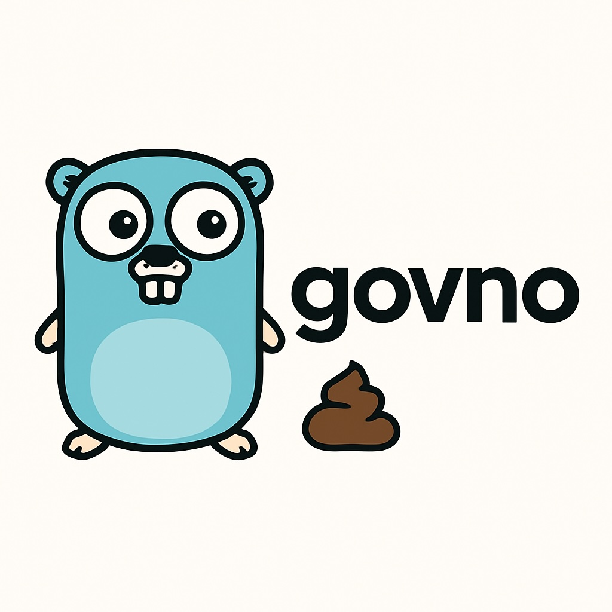

# GO VNO

[](https://github.com/nicklasos/govno/actions/workflows/ci.yml)
[](https://github.com/nicklasos/govno/releases)
[](https://goreportcard.com/report/github.com/nicklasos/govno/v2)

VNO protocol implementation in Go<br>
VNO stands for Very Needed Object<br><br>



**govno** makes rotating MySQL backups to S3. It runs `mysqldump`, gzips the output, and streams it to S3 (or any S3-compatible storage). The object key comes from a template. Each named schedule, a **vno** such as `daily` or `monthly`, is run from cron.

Rotation happens in one of two ways:

- **By key.** `{weekday}.sql.gz` gives you 7 rolling daily backups, because each Monday overwrites the last Monday. `{day}.sql.gz` gives a monthly cycle.
- **By count.** `keep = 30` deletes everything but the newest 30 backups of that vno after each successful run.

A failed dump never overwrites a good backup: mysqldump output is streamed straight into the upload, and any error aborts it.

## Install

**Binary**: download from [Releases](https://github.com/nicklasos/govno/releases) (linux/darwin, amd64/arm64):

```bash
VERSION=2.0.0
curl -sL https://github.com/nicklasos/govno/releases/download/v${VERSION}/govno_${VERSION}_linux_amd64.tar.gz | tar xz govno
sudo mv govno /usr/local/bin/
```

**Go**:

```bash
go install github.com/nicklasos/govno/v2/cmd/govno@latest
```

**Docker** (includes the `mysqldump` client):

```bash
docker pull ghcr.io/nicklasos/govno:2
```

`mysqldump` must be on `PATH` (`apt install default-mysql-client` / `brew install mysql-client`).

## Usage

```
govno [flags] <vno>

  -config string      config file (default $GOVNO_CONFIG, ~/.govno or /etc/govno/govno.toml)
  -db string          only back up this database
  -dry-run            show what would be uploaded and deleted without doing it
  -log-format string  log format: text or json (default "text")
  -version            print version and exit
```

Every database that has a vno with the given name is backed up. If one database fails, the others still run, and the exit code is `1`. A vno name that matches nothing is an error.

### Cron

```cron
0 3 * * *   govno -config /etc/govno/govno.toml daily   >> /var/log/govno.log 2>&1
0 4 1 * *   govno -config /etc/govno/govno.toml monthly >> /var/log/govno.log 2>&1
```

### Docker

```bash
docker run --rm \
  -v /etc/govno:/etc/govno:ro \
  -e AWS_ACCESS_KEY_ID -e AWS_SECRET_ACCESS_KEY \
  ghcr.io/nicklasos/govno:2 daily
```

<details>
<summary>Kubernetes CronJob</summary>

```yaml
apiVersion: batch/v1
kind: CronJob
metadata:
  name: govno-daily
spec:
  schedule: "0 3 * * *"
  concurrencyPolicy: Forbid
  jobTemplate:
    spec:
      template:
        spec:
          restartPolicy: OnFailure
          containers:
            - name: govno
              image: ghcr.io/nicklasos/govno:2
              args: ["-log-format", "json", "daily"]
              volumeMounts:
                - { name: config, mountPath: /etc/govno, readOnly: true }
          volumes:
            - name: config
              secret: { secretName: govno-config } # govno.toml + *.cnf
```

</details>

## Configuration

```toml
# Default storage for every database.
[s3]
bucket = "my-backups"
region = "us-west-2"
prefix = "mysql/"                      # prepended to every key (optional)
# endpoint = "http://localhost:9000"   # MinIO, Cloudflare R2, … (optional)
# access_key_id = ""                   # optional; see Credentials
# secret_access_key = ""

[[database]]
name = "shop"
defaults_file = "backup.cnf"           # mysql client options; relative to this file

  # 7 rolling daily backups.
  [[database.vno]]
  name = "daily"
  path = "{db}/daily/{weekday}.sql.gz"

  # One per month, keep the last 12.
  [[database.vno]]
  name = "monthly"
  path = "{db}/monthly/{year}-{month}.sql.gz"
  keep = 12

[[database]]
name = "blog"
defaults_file = "/etc/govno/blog.cnf"
host = "10.0.0.5"                      # overrides host from defaults_file (optional)
mysqldump_args = ["--routines", "--triggers"]

  [database.s3]                        # per-database override; unset fields come from [s3]
  bucket = "blog-backups"

  [[database.vno]]
  name = "daily"
  path = "{hostname}/{db}/{date}.sql.gz"
  keep = 30
```

| Key | Description |
| --- | --- |
| `s3.bucket` | Bucket name. Required, either globally or per database. |
| `s3.region` | AWS region. Falls back to `AWS_REGION` / `~/.aws/config`. |
| `s3.prefix` | Prepended to every object key. |
| `s3.endpoint` | Custom S3-compatible endpoint. Enables path-style addressing. |
| `s3.access_key_id`, `s3.secret_access_key` | Static credentials. Set both or neither. |
| `database.name` | Database to dump. Required. |
| `database.defaults_file` | mysql option file passed as `--defaults-file`. Required. |
| `database.host` | Passed as `--host`. |
| `database.mysqldump_args` | Extra mysqldump arguments. |
| `database.vno.name` | Schedule name used on the command line. |
| `database.vno.path` | Object key template (see below). |
| `database.vno.keep` | Keep only the newest N matching backups. `0` (the default) keeps everything. |

`defaults_file`, e.g. [`examples/backup.cnf`](examples/backup.cnf). Keep it `chmod 600`:

```ini
[client]
user=backup
password=secret
host=localhost
```

mysqldump always runs with `--single-transaction --quick`.

### Path placeholders

| Placeholder | Example | Description |
| --- | --- | --- |
| `{year}` | `2026` | |
| `{month}` | `03` | zero-padded |
| `{day}` | `05` | zero-padded |
| `{hours}` `{minutes}` `{seconds}` | `07` | zero-padded |
| `{date}` | `2026-03-05` | |
| `{weekday}` | `4` | ISO weekday, 1 = Monday … 7 = Sunday |
| `{week}` | `2` | week of the month (1–6, weeks start on Monday) |
| `{timestamp}` | `1772694489` | Unix seconds |
| `{hostname}` | `web-1` | machine running govno |
| `{db}` | `shop` | database name |
| `{vno}` | `daily` | vno name |

Unknown placeholders are rejected when the config loads, so a typo won't silently produce a weird key.

### Retention (`keep`)

After a successful upload, govno lists the objects under the static part of the template (everything before the first `{`). It keeps those that match the template for this database. Time placeholders match any number, while `{db}`, `{vno}` and `{hostname}` must match exactly. It then deletes all but the newest `keep`, by last-modified time. The backup that was just written is never deleted. Run with `-dry-run` first to see what would be removed.

Give each vno its own directory (`{db}/daily/…`, `{db}/monthly/…`) so their retention doesn't overlap.

### Credentials

If no `access_key_id` is configured, govno uses the standard [AWS credential chain](https://docs.aws.amazon.com/sdk-for-go/v2/developer-guide/configure-gosdk.html#specifying-credentials): environment variables, `~/.aws/credentials`, SSO, then an EC2/ECS/EKS role. A minimal IAM policy:

```json
{
  "Version": "2012-10-17",
  "Statement": [
    { "Effect": "Allow", "Action": ["s3:PutObject", "s3:DeleteObject", "s3:AbortMultipartUpload"], "Resource": "arn:aws:s3:::my-backups/*" },
    { "Effect": "Allow", "Action": "s3:ListBucket", "Resource": "arn:aws:s3:::my-backups" }
  ]
}
```

`s3:DeleteObject` is only needed if you use `keep`.

## Migrating from v1

| v1 | v2 |
| --- | --- |
| `cnf = "config.cnf"` | `defaults_file = "config.cnf"` (now actually used, relative to the config file) |
| `aws_bucket`, `aws_region` | `[s3]` `bucket`, `region`, globally or under `[database.s3]` |
| `aws_id`, `aws_key` | `[s3]` `access_key_id`, `secret_access_key`, or better, the AWS credential chain |
| `govno daily govno.toml` | `govno -config govno.toml daily` |
| `{month}` → `3` | `{month}` → `03` (all date parts are zero-padded) |

In v1 the `path` template was ignored, and backups landed in the bucket root as `<nanotime>.<vno>.<db>.dump.sql.gz`. After upgrading, backups go to the configured paths, so you can delete the old root-level objects once you are happy.

## Development

```bash
make test         # unit tests with -race
make lint         # golangci-lint v2
make integration  # end-to-end dump → upload → prune (fake S3; real MySQL via GOVNO_IT_* vars)
make snapshot     # local GoReleaser build into dist/
```

Releases are cut by pushing a `v*` tag. GitHub Actions builds the binaries with GoReleaser, takes the release notes from [CHANGELOG.md](CHANGELOG.md), and publishes the Docker image to GHCR.

## License

[WTFPL](LICENSE.md)
